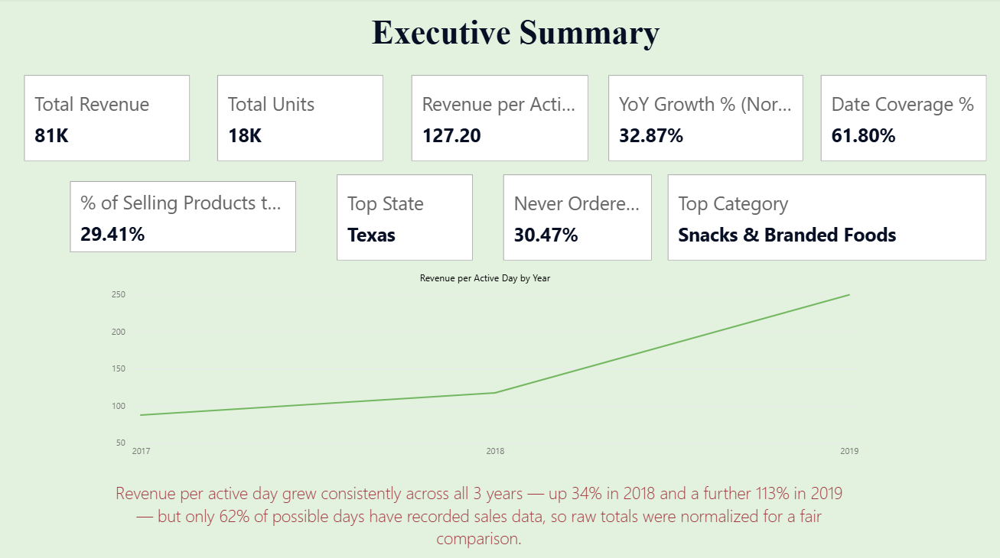
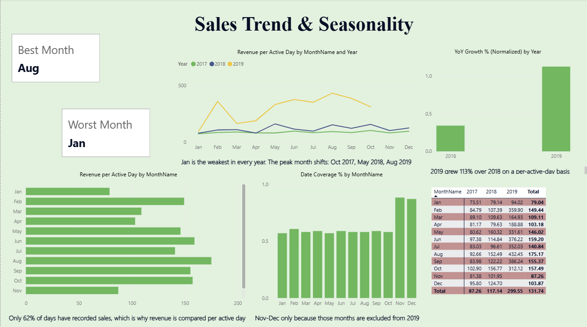
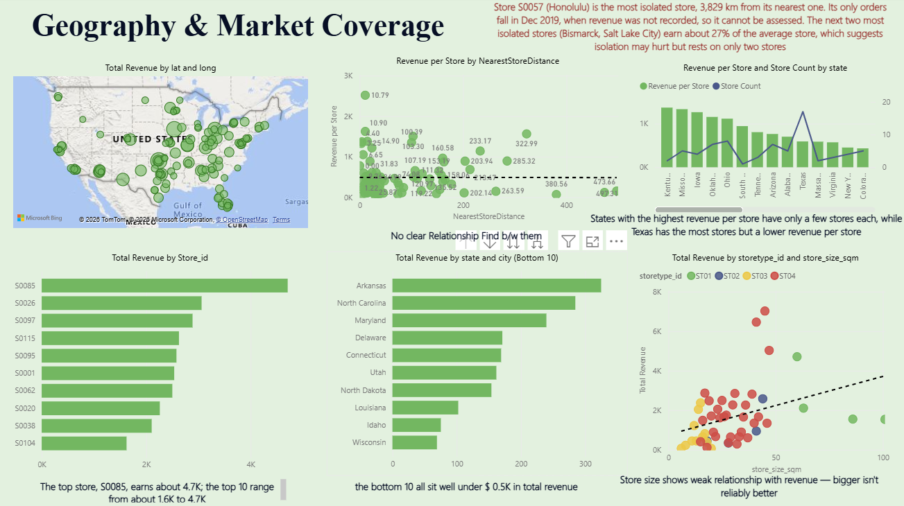
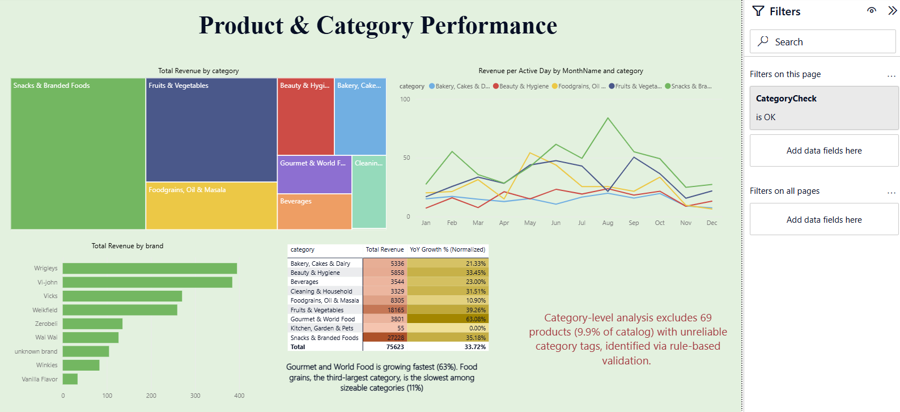
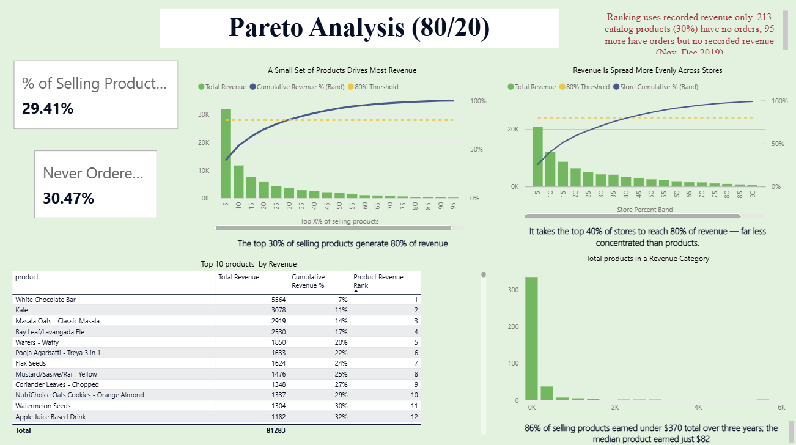
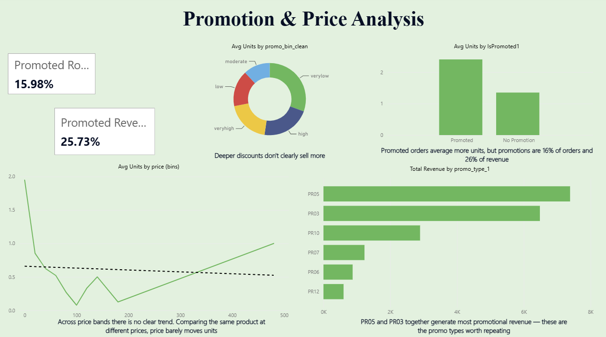
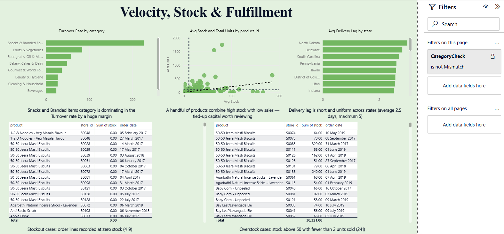
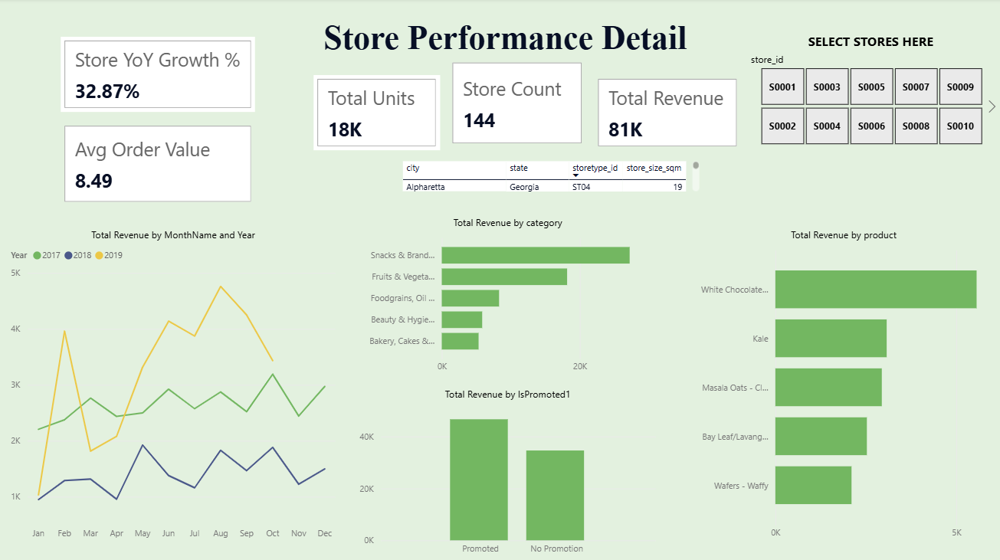
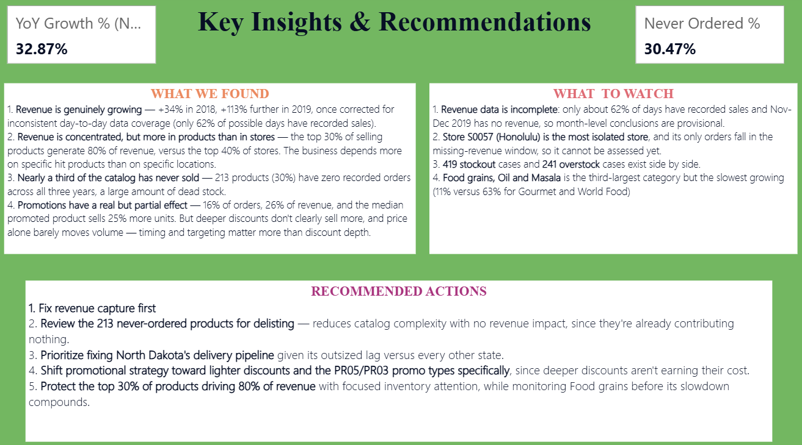

# Retail Sales Analytics: Findings by Page

All figures were checked against the underlying data. Revenue comparisons across years use **revenue per active day** because daily coverage differs sharply by year.

## Page 1: Executive Summary

- Total revenue 81K; 18K units.
- Revenue per active day: **87 (2017), 117 (2018), 249 (2019)**. Growth of **+34%** then **+113%**.
- Only **62%** of possible days have recorded data.
- Top state: Texas. Top category: Snacks and Branded Foods.
- 30.5% of catalogue products have never been ordered; 29.4% of selling products generate 80% of revenue.

## Page 2: Trend and Seasonality

- **January is the weakest month in all three years.**
- The peak month changes by year: **October 2017, May 2018, August 2019**.
- On a year-normalised basis (each year's own average = 1.00), August is highest at about 1.27, then October at about 1.19.
- Nov-Dec 2019 is excluded from trend visuals because revenue was not recorded in those months.
- Pooled monthly values for Nov and Dec must also exclude 2019 days, otherwise they are understated.

## Page 3: Geography and Market Coverage

- Texas, Ohio and Oklahoma lead by state revenue. The top store earns about 4.7K.
- Store size has only a weak positive relationship with revenue.
- Store count does not track revenue closely across states, which hints at coverage gaps.
- The most isolated store (Honolulu, 3,829 km from its nearest neighbour) has orders only in 1-7 December 2019, inside the period with no recorded revenue, so its performance cannot be assessed.
- The next two most isolated stores (Bismarck, Salt Lake City) earn about 27% of the average store. This is suggestive only, based on two stores.

## Page 4: Product and Category

Revenue (valid-category products) and per-day growth:

| Category | Revenue | YoY growth |
|---|---|---|
| Snacks and Branded Foods | 27,228 | 35% |
| Fruits and Vegetables | 18,165 | 39% |
| Foodgrains, Oil and Masala | 8,305 | **11%** |
| Beauty and Hygiene | 5,858 | 33% |
| Bakery, Cakes and Dairy | 5,336 | 21% |
| Gourmet and World Food | 3,801 | **63%** |
| Beverages | 3,544 | 23% |
| Cleaning and Household | 3,329 | 32% |
| Kitchen, Garden and Pets | 55 | 0% |

- 69 products (9.9%) were excluded from category visuals because their category tags did not match the product.

## Page 5: Pareto (80/20)

- 391 products have recorded revenue. **115 of them (29.4%) generate 80% of revenue.**
- The top 10 products produce about 29% of revenue; the top product (White Chocolate Bar) about 6.8%.
- 86% of selling products earned under about $370 over three years; the median product earned $82.
- For stores, **58 of 143 (41%)** are needed for 80% of revenue, so concentration is lower than for products.
- 213 products (30%) have no orders; 95 more have orders but no recorded revenue.

## Page 6: Promotion and Price

- Promoted order lines are about 16% of the total but 26% of revenue. Code PR14 means no promotion.
- Comparing the same product promoted versus not: median lift about 25% more units; about 64% of comparable products sell more when promoted.
- Discount depth is not monotonic: the lightest tier has the highest average units per order.
- Within a product, the relationship between price and units is close to zero (correlation about -0.03).
- PR05 and PR03 earn the most promotional revenue.

## Page 7: Velocity, Stock and Fulfilment

- 419 order lines at zero stock; 241 with stock above 50 and fewer than 2 units sold.
- Snacks and Branded Foods has the highest stock turnover.
- Delivery lag is short and uniform: **mean 2.45 days, median 2, maximum 5**. The slowest state is North Dakota at about 3.0 days on only 18 orders. This is not a bottleneck.

## Page 8: Store Detail

Choose a store in the slicer. Shows store identity, revenue, units, average order value, store-level YoY growth, monthly trend, top categories, top products and promoted versus non-promoted revenue.

## Page 9: Key Insights and Recommendations

1. Fix revenue capture (62% day coverage; Nov-Dec 2019 missing).
2. Review the 213 never-ordered products for delisting.
3. Protect the roughly 115 products carrying 80% of revenue; rebalance shortage versus excess stock.
4. Use targeted, lighter promotions (PR05, PR03); do not assume deeper discounts lift volume.
5. Watch Foodgrains, the third-largest and slowest-growing sizeable category.
6. Re-assess store S0057 once its December 2019 revenue is available.
